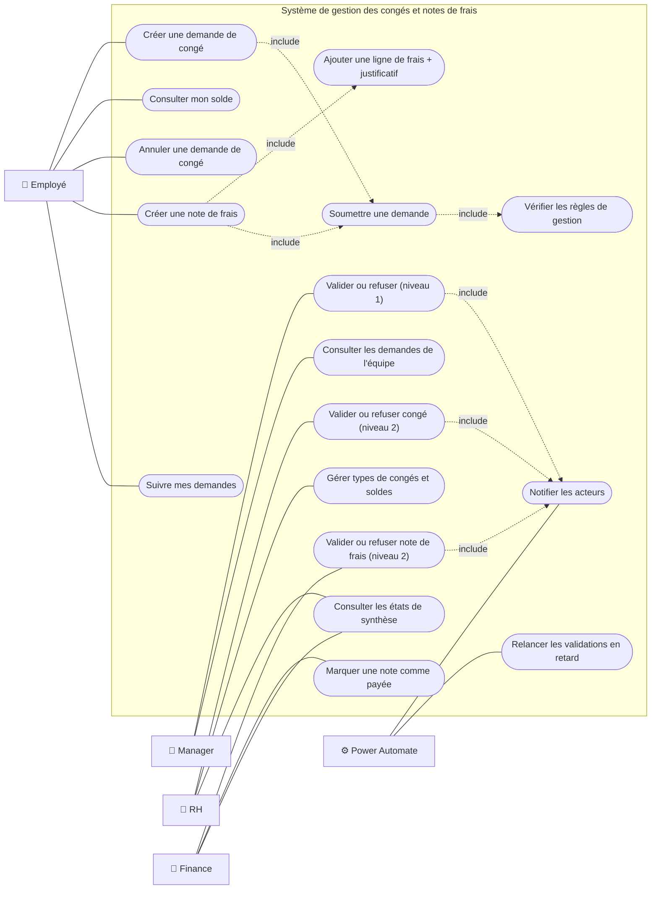
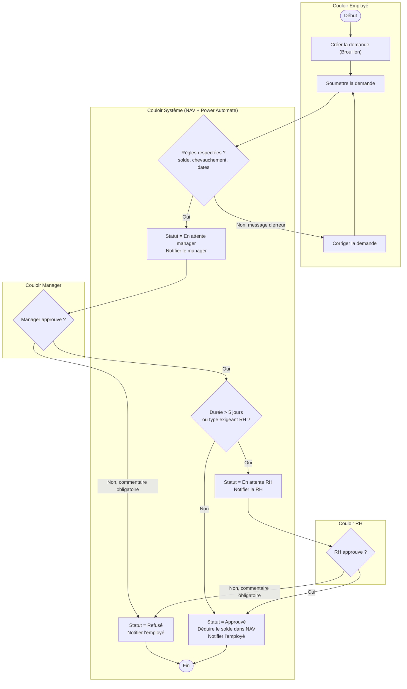
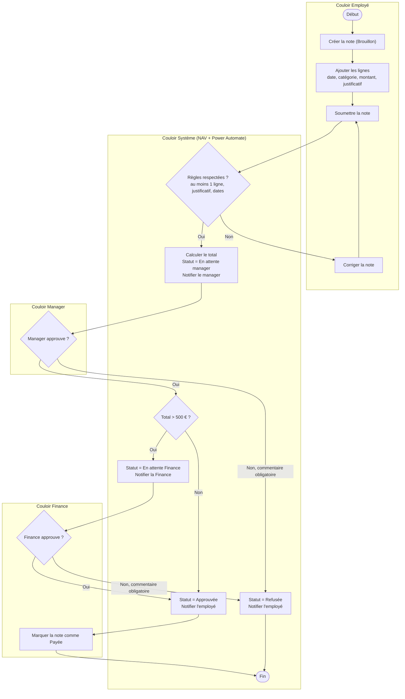
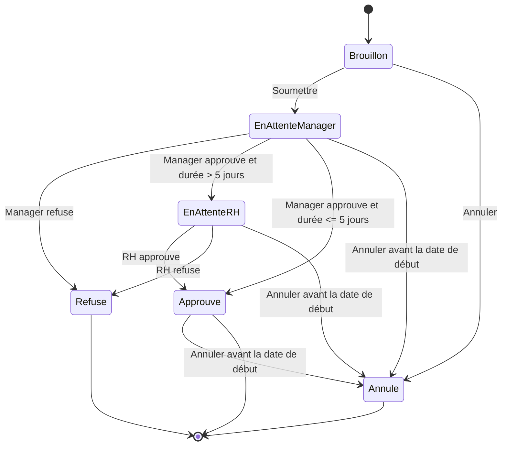
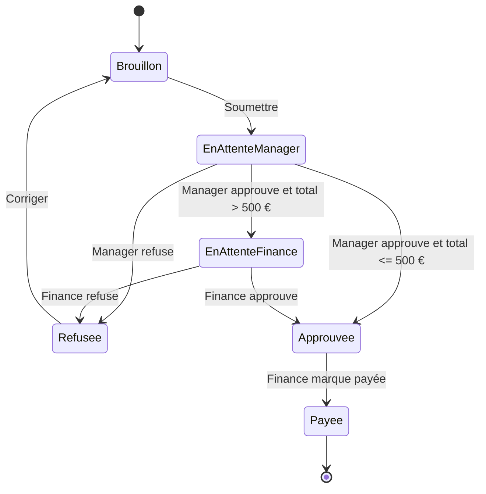
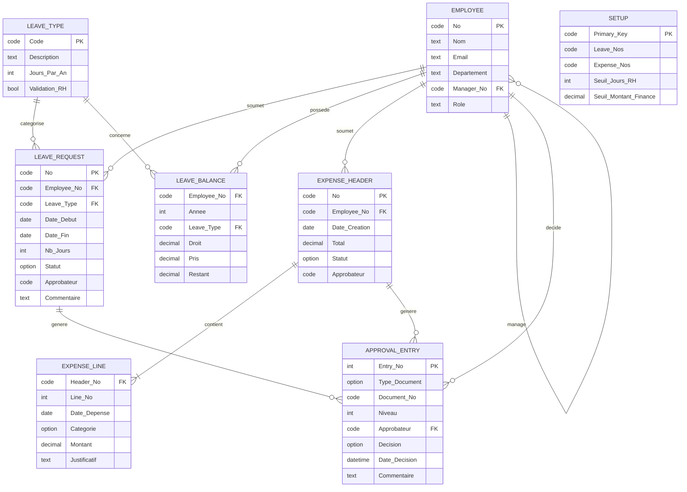
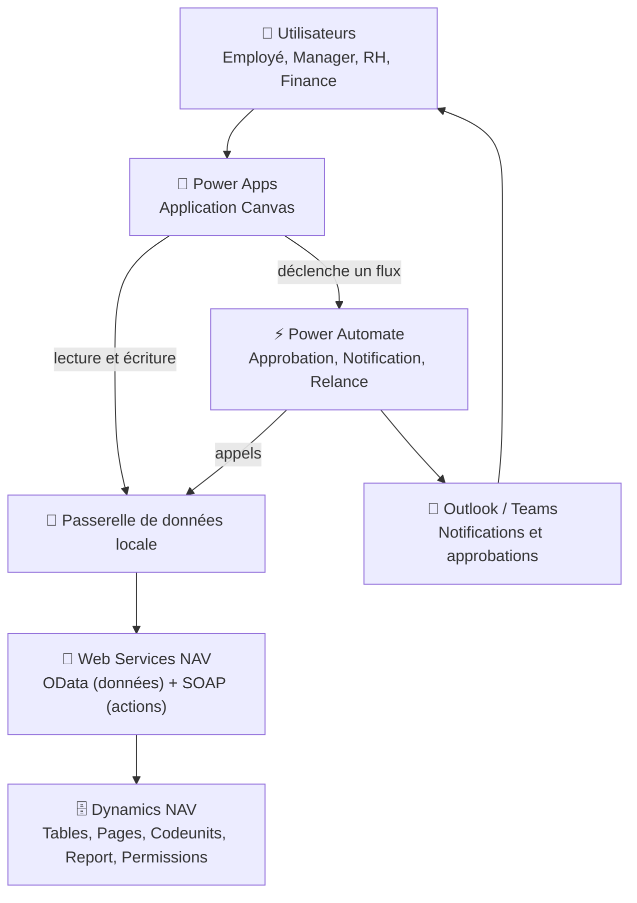

# Modélisation : Gestion des notes de frais et des congés

> Les diagrammes sont écrits en Mermaid et s'affichent directement sur GitHub.
> Entreprise fictive : [NOM DE L'ENTREPRISE]

---

## 1. Diagramme de cas d'utilisation

**Acteurs :** Employé, Manager, RH, Finance (acteurs humains) ; Power Automate (acteur système).

---

## 2. Diagramme d'activité : processus de congé (avec couloirs)

---

## 3. Diagramme d'activité : processus de note de frais

---

## 4. Diagrammes d'états (cycle de vie)

### 4.1 Demande de congé

### 4.2 Note de frais

---

## 5. Modèle de données

**Remarque :** `APPROVAL_ENTRY` référence un congé ou une note de frais via `Type_Document` + `Document_No` (relation polymorphe, pas de clé étrangère directe). `Employee` est la table standard NAV (no. 5200), on la réutilise.

---

## 6. Architecture de la solution

**Flux principal :** l'employé soumet dans Power Apps ; Power Apps écrit dans NAV via OData puis déclenche le flux d'approbation ; Power Automate envoie l'approbation au manager (Teams/Outlook) ; la décision met à jour NAV via SOAP ; l'employé est notifié.

---

## 7. Matrice des droits (aperçu)

| Objet | Employé | Manager | RH / Finance |
|---|---|---|---|
| Leave Request | Lire/écrire (les siennes) | Lire (équipe), modifier statut | Lire tout, modifier statut |
| Leave Balance | Lire (le sien) | Lire (équipe) | Lire/écrire |
| Leave Type | Lire | Lire | Lire/écrire |
| Expense Header / Line | Lire/écrire (les siennes) | Lire (équipe), modifier statut | Lire tout, modifier statut |
| Approval Entry | Lire (les siennes) | Lire/insérer | Lire/insérer |
| Setup | Aucun | Aucun | Lire/écrire |
| Report de synthèse | Aucun | Équipe | Tous |
